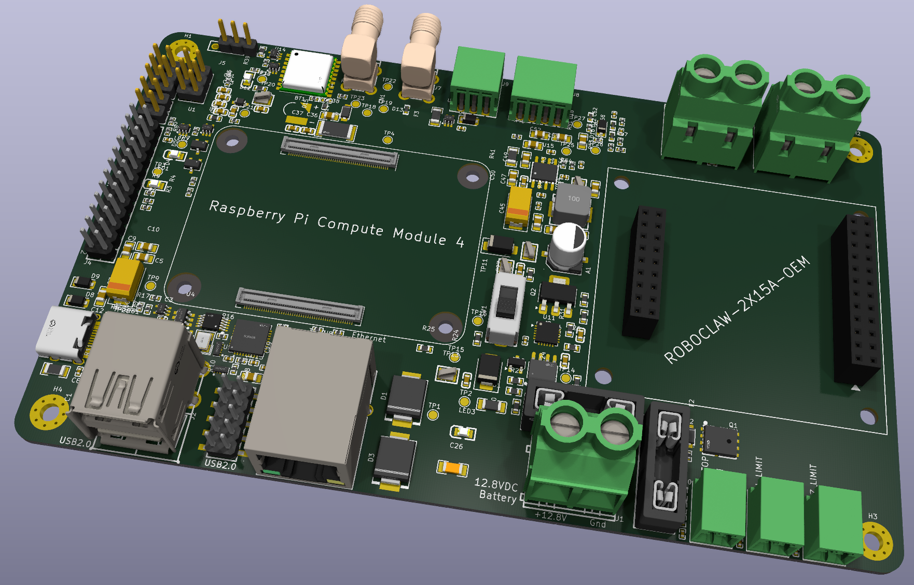
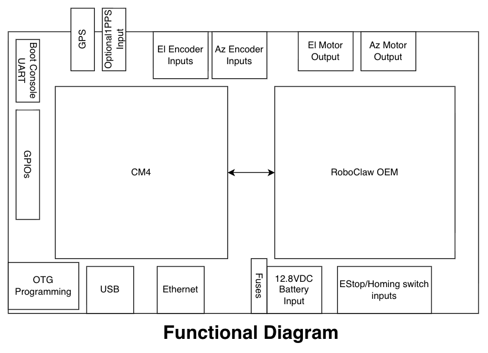
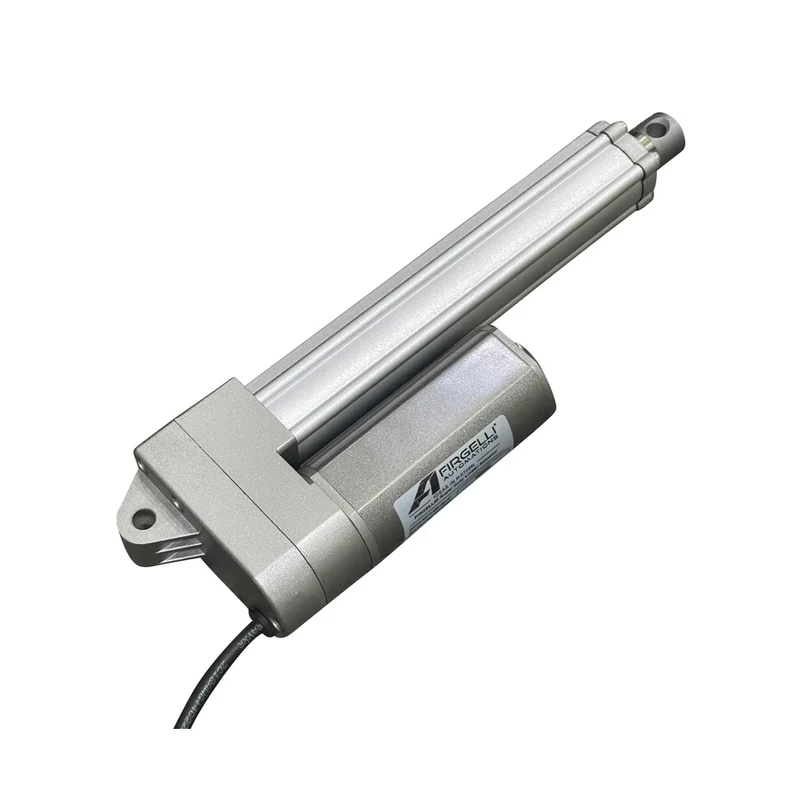
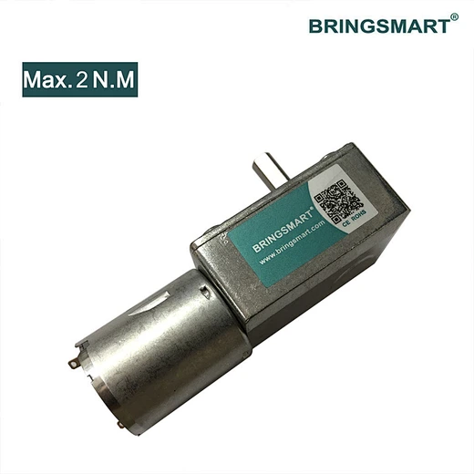
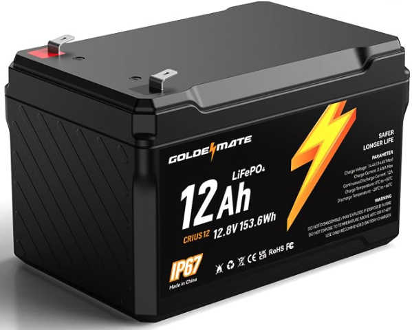
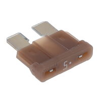
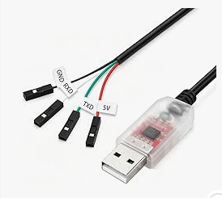

# roboclaw-cm4-dc-dish-controller

A satellite dish controller board. A Raspberry Pi Compute Module 4 (CM4) commands a
Basicmicro **RoboClaw 2x15A OEM** motor controller that drives the dish's azimuth and
elevation motors. The board runs from a 12.8 V LiFePO4 battery.

**Schematic:** [kicad/cm4-robo-controller.pdf](kicad/cm4-robo-controller.pdf)

[Tomachie AI](https://tomachie.com) reviewed the schematic. Here is the [Certificate of Accomplishment](https://tomachie.com/v/b25c2e633f5102c3428ca107923799f4ff11). Scored 94/100 (which I think is pretty good).



## Overview

The board combines two modules:

- **Raspberry Pi CM4**: runs the pointing software and provides networking, USB,
  GPS timing and spare I/O. It plugs into two Hirose mezzanine connectors in the
  middle of the board.
- **RoboClaw 2x15A OEM**: a dual-channel brushed DC motor controller with
  closed-loop position and speed control. It plugs into two pin-header sockets on
  the right of the board. The CM4 sends it commands over a TTL serial link
  (RoboClaw packet serial).

The CM4 decides where the dish should point. The RoboClaw reads the axis sensors
and runs the motor control loops.



The functional diagram shows the board's layout: the CM4 on the left, the RoboClaw
on the right, and the field connections along the edges. Its source is
`drawings/FunctionalDiagram.drawio`.

## Motors and axis sensing

| Axis | Motor | Position sensor | RoboClaw input |
|---|---|---|---|
| Elevation (M1) | Firgelli F-SD-H-450-12V linear actuator (5.5 A max, 450 lb) | Built-in Hall sensors, quadrature A/B | EN1 |
| Azimuth (M2) | Bringsmart JGY-370 12 V worm-gear motor (1.8 A max) | AS5600 magnetic angle sensor, analog output | EN2 |

| Elevation: Firgelli F-SD-H-450 linear actuator | Azimuth: Bringsmart JGY-370 worm-gear motor |
|:---:|:---:|
|  |  |

- **Elevation:** the actuator's Hall outputs (J8) are pulled up to the RoboClaw's
  5 V supply, ESD-protected and RC-filtered before they reach EN1. The count is
  incremental, so the axis is homed at start-up.
- **Azimuth:** the AS5600 (J9) gives an absolute angle as a 0–3.3 V signal. A
  68k/100k divider scales it to the RoboClaw's 0–2 V analog input, so no homing is
  needed.
- **Switch inputs:** E-stop (J10 → S3), elevation limit (J12 → S4) and azimuth
  limit (J13 → S5). All use normally-closed switches and have ESD protection and
  filtering.
- **Motor outputs:** J11 and J14, both 7.62 mm screw terminals.

The `Motor Notes` schematic sheet describes the sensor wiring and RoboClaw setup in
detail.

## Power



- **Input:** a 12.8 V, 12 Ah LiFePO4 battery (10.0–14.6 V) on J1, a 7.62 mm screw
  terminal. The battery is a GoldenMate CRIUS12, IP67 rated, and sits inside the
  enclosure. Its manual is in `docs/`.
- **Reverse-polarity protection:** a P-channel MOSFET (Q1) on the input blocks a
  battery connected backwards. It still conducts in both directions in normal use,
  so motor regenerative braking can return energy to the battery.
- **Fuses:** two ATO blade fuses split the supply:
  - F1 (15 A) feeds the RoboClaw motor supply (V_MOTOR).
  - F2 (5 A) feeds the logic branch.

  

  These are ordinary automotive blade fuses, the kind sold for car wiring. They are
  cheap and available almost anywhere. They plug into Keystone 3557-2 holders, so a
  blown fuse can be replaced in the field without tools. The board uses Littelfuse
  0287005.PXCN (5 A) and 0287015.PXCN (15 A), but any ATO/ATC fuse of the same
  rating fits.

  Q1 is the main protection against a reversed battery. A healthy Q1 blocks the
  reverse voltage, and no fuse should blow. The fuses are the backup. If Q1 has
  failed shorted, the reversed battery drives current forward through the input TVS diodes (D1, D3) and the
  RoboClaw's internal diodes. That current passes through F1 and F2, and the fuses
  are what stop it. A blown fuse after connecting the battery therefore means:
  check the polarity, and check Q1, before you fit a new fuse.

  The fuses do not cover every reverse fault. If board ground is also connected to
  the battery's negative terminal by another route, such as a USB device or other
  equipment that shares the battery, reverse current can flow through the ground
  wiring and bypass both Q1 and the fuses. 
- **Logic supply:** the logic branch goes through a hot-swap eFuse (U11), a power
  switch (SW1) and a 5 A buck converter (U15). The buck makes 5 V for the CM4 and the
  USB ports. The CM4's own 3.3 V output powers the 3.3 V logic.
- **SW1 is not a battery disconnect.** It switches the CM4 and logic supply only.
  With SW1 off the board still draws about 31 mA from the battery: about 30 mA for
  the RoboClaw's logic, which runs straight from V_MOTOR, plus about 1.3 mA for U11
  and its dividers. A full 12 Ah battery runs flat in about 16 days. For storage or
  transport, unplug J1 (or pull F1 and F2), and charge the battery first. A LiFePO4
  battery left at its BMS cutoff for months loses capacity.
- **Grounding:**
  - Motor return current stays on a separate ground (PGND). It joins the logic
    ground at a single point (NT1) next to the battery terminal.
  - Connector shields and mounting holes go to CHASSIS, which is bled to ground
    through 1 MΩ in parallel with 4.7 nF.

## CM4 interfaces

- **Ethernet:** gigabit RJ45 with integrated magnetics. The PHY is on the CM4.
- **USB:**
  - A USB2514B hub drives a dual USB-A port and a 2-port expansion header (J2),
    with current limiting and ESD protection.
  - A USB mux switches the CM4's USB port to the USB-C connector for `rpiboot`
    (OTG programming of the eMMC).
- **GPS:**
  - A u-blox MAX-M10S receiver provides UTC time and a 1PPS pulse. Its antenna
    connects to an SMA jack, and a coin cell backs up the receiver for fast restarts.
  - A second SMA input accepts an external 1PPS reference, such as an FE-5680A
    rubidium clock.
- **GPIO header (J4):** spare CM4 GPIOs and two protected analog inputs.
- **Jumpers:** boot control, EEPROM write protect and self power-cycle.
- **Boot console UART (J5):** a serial console on the CM4's UART0. See below.

### Boot console UART (J5)

J5 is a 3-pin, 2.54 mm header that brings out the CM4's UART0. It shows bootloader
and Linux boot messages and gives a login prompt. That makes it the way into the
board when the network is down or the CM4 won't boot.

| J5 pin | Signal | Connect to the adapter's |
|---|---|---|
| 1 | BOOT_CONSOLE_RXD (GPIO15, CM4 receives) | TXD |
| 2 | BOOT_CONSOLE_TXD (GPIO14, CM4 transmits) | RXD |
| 3 | GND | GND |

TX and RX cross over: the adapter's TXD goes to the CM4's RXD.



Any inexpensive USB-to-TTL serial cable works. Cables like the one shown, based on
the PL2303, CP2102 or FTDI chips, cost a few dollars on Amazon. They usually have
four female jumper leads: black GND, white RXD, green TXD and red 5V. Check the
labels on your cable.

- **Do not connect the red 5V lead.** The board powers itself, and J5 has no 5 V
  pin. A loose 5 V lead can short against the header or the board, so it's best
  to cut it off, or at least insulate it.
- **Use a cable with 3.3 V signals.** The CM4's GPIOs are not 5 V tolerant. Before
  connecting, check with a meter that the adapter's TXD idles at about 3.3 V.
- **Settings:** 115200 baud, 8N1, no flow control.
- **Enabling the console:**
  - For the Linux console, add `enable_uart=1` to `config.txt`. Raspberry Pi OS
    already puts `console=serial0,115200` in `cmdline.txt`.
  - For bootloader messages, set `BOOT_UART=1` in the EEPROM config with
    `rpi-eeprom-config`.

### Recommended CM4

Use a **CM4 without wireless and with eMMC**, for example `CM4004032` (4 GB RAM,
32 GB eMMC) or `CM4004016` (16 GB eMMC).

- The board has no SD-card slot, so a CM4 Lite (part numbers ending `000`) cannot
  boot on it.
- On a wireless CM4, Bluetooth takes UART0, which this board uses.

## Board

- 4-layer PCB, 150 × 90 mm, with four M3 mounting holes.
- Assembled on one side by JLCPCB. Parts carry LCSC part numbers.
- The RoboClaw sits in sockets (J15/J16) so it can be removed. Nothing is placed
  under the CM4 or the RoboClaw.
- The inner layers are planes:
  - In1.Cu is ground, split into logic GND and PGND.
  - In2.Cu carries power: +5 V on the logic side, V_MOTOR on the RoboClaw side.

## Status

The schematic is complete. PCB placement and plane layout are done, and routing is
in progress. The software has not been started yet.

## Repository layout

| Path | Contents |
|---|---|
| `kicad/` | KiCad 10 project: schematic sheets and PCB |
| `parts/` | Git submodule ([jrseti/parts](https://github.com/jrseti/parts)): the `MyParts` symbol, footprint and 3D-model library, its datasheets, and `add.py` for importing LCSC parts |
| `docs/` | Component datasheets and design notes |
| `drawings/` | Draw.io source for the functional diagram |
| `images/` | Images used in this README |
| `software/` | CM4 software (not yet started) |

### Cloning

`parts/` is a submodule, and the KiCad project needs it to find its symbols,
footprints and 3D models. Clone with:

```sh
git clone --recurse-submodules https://github.com/jrseti/roboclaw-cm4-dc-dish-controller.git
```

If you have already cloned the repository, run `git submodule update --init` to
fetch it.

KiCad finds the library through two path variables. Set them in
**Preferences → Configure Paths**:

| Variable | Value |
|---|---|
| `MYPARTS` | `<clone>/parts` |
| `MYPARTS_DATASHEETS` | `<clone>/parts/datasheets` |

## License

MIT. See [LICENSE](LICENSE).
