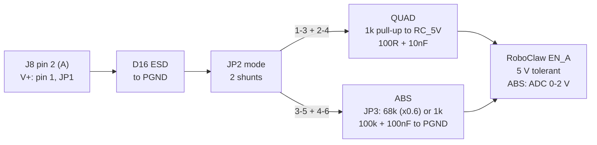

# Encoder Input Circuits

How the RoboClaw encoder channels (ENC1 on J8, ENC2 on J9) handle the three
encoder types the board is designed for: the Omron E6B2-CWZ6C (NPN
open-collector quadrature), the Firgelli F-SD-H-450 Hall sensors (quadrature) and
an absolute analog encoder such as the AS5600. Schematic: `Robo` sheet
(`kicad/robo.kicad_sch`); wiring tables: `Motor Notes` sheet.

## One channel, three encoders

ENC1 (J8 → RoboClaw EN1, motor M1) and ENC2 (J9 → EN2, motor M2) are the same
circuit; only the reference designators differ. Three shunt headers per channel
select the sensor supply, the signal mode and the analog scaling, and the
RoboClaw end never sees more than 5 V or, in absolute mode, 0–2 V.

| Stage | ENC1 parts | ENC2 parts | What it does |
|---|---|---|---|
| Connector (4-pin terminal block) | J8 | J9 | 1 V+ · 2 A or analog in · 3 B · 4 GND (PGND) |
| Supply jumper (2x3, shunt across a row) | JP1 | JP4 | 1-2 = 5 V (RC_5V) · 3-4 = 3.3 V (U18) · 5-6 = battery 10–14.6 V (ENC_12V) |
| ESD clamps on pins 2 and 3 | D16, D18 | D22, D27 | TPESD0402G12V to PGND, 0.05 pF |
| Mode header (2x3) | JP2 | JP5 | 1-3 + 2-4 = QUAD, 3-5 + 4-6 = ABS; swaps the whole network on A |
| QUAD network on A | R47 1k, R49 100R, C57 10nF | R102, R103, C87 | pull-up to RC_5V, then 100R/10nF to EN_A |
| Network on B (always fitted) | R51 1k, R53 100R, C59 10nF | R105, R106, C88 | same as QUAD A, straight to EN_B |
| ABS network on A | JP3, R99 68k, R100 1k, R101 100k, C86 100nF | JP6, R57, R104, R58, C62 | JP3 1-2 = ×0.595 divider, 2-3 = 1k series; 100k/100nF node to EN_A |
| 12 V branch (shared) | F4 250 mA PTC, D28 SMAJ20A, C89 10 µF | — | V_MOTOR → ENC_12V, on the RoboClaw ground |

Two decisions carry all three cases. The pull-ups go to a fixed 5 V (RC_5V),
not to the selected V+, so a 12 V sensor supply can never reach the RoboClaw
inputs. In ABS mode the two shunts lift the entire quadrature network, pull-up
included, off pin A, so nothing loads or lifts the analog signal.

The two shunts on JP2 route pin A through either the quadrature network or the
analog network; pin B always takes a copy of the quadrature network straight to
EN_B.

## 1. Omron E6B2-CWZ6C: NPN open-collector

The E6B2-CWZ6C output is a bare NPN transistor that can only pull its line to
0 V; the board supplies the high level through the 1k pull-up, so the RoboClaw
sees a clean 0–5 V square wave whatever the encoder's own supply is. Settings:
JP1/JP4 on 5-6 (12 V) or 1-2 (5 V), JP2/JP5 in QUAD, JP3/JP6 unused.

**Wiring to J8 or J9:** brown V+ → 1, black A → 2, white B → 3, blue 0 V → 4.
Orange Z is not used (insulate it). The cable shield is not bonded to 0 V inside
the encoder, so clamp it to the enclosure at the gland.

How each part of the path handles it:

1. **Supply.** The encoder accepts 5 V −5 % to 24 V +15 % and draws up to
   80 mA. On 5-6 it runs from the battery (10–14.6 V) through F4 (250 mA PTC),
   clamped by D28 (SMAJ20A) and bypassed by C89; the 5 V BEC's 5.0 V nominal is
   also inside its range on 1-2. Both returns are PGND, the RoboClaw ground.
2. **ESD.** D16/D18 (D22/D27) clamp the two signal pins at the connector.
3. **Pull-up.** Through JP2 1-3 the A line reaches R47; B always has R51. Both
   are 1k to RC_5V, so the open-collector sinks 5 mA when low (rated 35 mA) and
   the line rests at 5 V when the transistor is off. Because the pull-up is to
   5 V and not to the 12 V sensor supply, the logic level is 5 V regardless of
   JP1/JP4; the transistor itself is rated 30 V.
4. **Filter.** R49 100R + C57 10nF (τ = 1 µs, about 160 kHz) remove cable
   ringing. The falling edge is fast; the rising edge is set by the pull-up
   charging the 10 nF through 100R + 1k, τ ≈ 11 µs. That is why the pull-ups
   were lowered from 5.1k (τ ≈ 52 µs): the channel is now good to about 20 kHz,
   so keep resolution × rpm / 60 under 20 kHz (a 1000 P/R encoder up to
   1200 rpm; the encoder itself stops at 100 kHz).
5. **RoboClaw.** Pins 1A/1B (2A/2B) are 5 V tolerant and have no filtering of
   their own; set the channel to quadrature in Motion Studio and swap A/B in
   software if the count runs the wrong way.

## 2. Firgelli F-SD-H-450: Hall-effect quadrature

The actuator's two Hall sensors are 90° apart and give A/B pulses on 5 V, so the
Firgelli uses the same QUAD path as the E6B2 and needs no other parts. Settings:
JP1 on 1-2 (5 V), JP2 in QUAD, JP3 unused; this is the ENC1 default.

**Wiring to J8:** red V+ → 1, yellow H1 → 2 (A), white H2 → 3 (B), black
GND → 4. The sensor is specified for 5–15 V and draws about 10 mA; J8-1 gives it
5 V from the RoboClaw BEC (800 mA shared, D21 SMF6.0A clamps the rail).

How the path handles it:

1. **Either output type works.** Firgelli does not publish whether the Hall
   outputs are open-collector or push-pull. With the 1k pull-up to 5 V an
   open-collector output behaves exactly as in section 1; a push-pull 5 V output
   simply drives the line and sources 5 mA into the pull-up when high, which is
   well within a Hall IC's drive. Either way the RoboClaw sees 0–5 V.
2. **Filter.** The pulse rate is low (a few hundred Hz at full stroke speed), so
   the 100R/10nF filter and the 11 µs open-collector rise time are irrelevant to
   counting; they only remove ringing from the actuator cable, which runs beside
   the 5.5 A motor leads.
3. **ESD** on both lines at the connector, as above.
4. **RoboClaw.** Counts in quadrature on EN1; position is the count and speed is
   the count rate. The count is lost at power-off, so the axis is homed at
   start-up against the elevation limit switch (J12 → S4) or by driving to full
   retraction with a low current limit, then zeroing the counter.

If a Firgelli unit turns out to have a single Hall output (some models have
3 wires), connect it to pin 2 only: the RoboClaw still counts it but cannot tell
direction, so direction must come from the commanded motion in software.

## 3. Absolute (analog) encoder, 0–2 V at the RoboClaw

In ABS mode the RoboClaw reads the voltage on pin A with its ADC, whose full
scale is 2 V, and treats it as an absolute position; the board's job is to
deliver a clean 0–2 V with nothing pulling the node toward 5 V. Settings:
JP2/JP5 on 3-5 + 4-6 (ABS), JP3/JP6 set to the sensor's output range, JP1/JP4 to
the sensor's supply. The ENC2 default is the AS5600: JP4 3-4 (3.3 V), JP5 ABS,
JP6 1-2.

**Wiring to J9 (or J8):** V+ → 1, analog OUT → 2, GND → 4. Pin 3 (B) stays
open; the board holds EN_B high through its own pull-up and the RoboClaw ignores
it in absolute mode.

How the path handles it:

1. **The quadrature network is removed, not just bypassed.** Moving the two
   shunts to 3-5 and 4-6 disconnects pin A from R47/R49/C57 at both ends, so the
   1k pull-up and the 10 nF cap are no longer on the signal. Only D22 (0.05 pF)
   stays on the input.
2. **Scaling, chosen on JP3/JP6.** 1-2 puts R57 68k in series with the R58 100k
   bottom resistor: 0–3.3 V from a 3.3 V-powered AS5600 becomes 0–1.96 V
   (×0.595), and the sensor sees 168k, above its 100k minimum load. 2-3 replaces
   the 68k with a 1k series resistor (×0.99) for a source that already outputs
   0–2 V, such as a potentiometer fed through the RoboClaw-manual divider
   (R1 = 1.5 × Rpot); the 100k bottom resistor then loads it by about 1 %.
3. **Filter.** C62 100nF sits on the EN_A node: τ = 4 ms (about 39 Hz) behind
   the 68k, or 0.1 ms behind the 1k. The RoboClaw manual asks for 0.1 µF on
   analog inputs for exactly this reason; the AS5600's 1 nF output-load limit is
   respected because the 68k isolates it from the cap.
4. **Supply.** The AS5600 runs at 3.3 V from U18, a TPS70933 LDO off RC_5V
   behind F3 (100 mA PTC) and D23 (SMBJ3V3), so a miswire on the field connector
   cannot back-feed the CM4 rail. A 5 V-powered sensor would output 0–5 V and
   need a different divider; keep the AS5600 at 3.3 V (VDD5V tied to VDD3V3 on
   the sensor board).
5. **RoboClaw.** Set EN2 to absolute encoder mode in Motion Studio; no homing is
   needed. The reading is single-turn, so mount the magnet so the azimuth travel
   never crosses the 0/360° wrap, or set ZPOS/MPOS. The divider's 40k source
   impedance is high enough that a RoboClaw internal pull-up, if it stays active
   in absolute mode, would lift the reading: measure EN_A with and without the
   RoboClaw fitted and calibrate the travel limits on hardware.

## Quick reference

| Encoder | Supply JP1/JP4 | Mode JP2/JP5 | Scale JP3/JP6 | Connector pins used |
|---|---|---|---|---|
| Omron E6B2-CWZ6C | 5-6 (12 V) or 1-2 (5 V) | QUAD | — | 1 V+, 2 A, 3 B, 4 GND; Z unused |
| Firgelli Hall A/B | 1-2 (5 V) | QUAD | — | 1 V+, 2 H1, 3 H2, 4 GND |
| AS5600 at 3.3 V | 3-4 (3.3 V) | ABS | 1-2 (×0.6) | 1 V+, 2 OUT, 4 GND |
| Any 0–2 V source | as the sensor needs | ABS | 2-3 (direct) | 1 V+, 2 OUT, 4 GND |

Bench checks before closing the enclosure:

- [ ] Supply shunt is across a row (1-2, 3-4 or 5-6); a vertical shunt (1-3, 3-5)
      shorts two rails.
- [ ] QUAD: both signal lines idle at 5 V and swing to below 0.4 V; count rises
      when the axis moves in its positive direction (else swap A/B in Motion
      Studio).
- [ ] ABS: EN_A reads 0–2 V over the full travel with the RoboClaw fitted; set
      the min/max position limits from the end-of-travel readings.
- [ ] RC_5V load: four 1k pull-ups (≤ 20 mA) plus the sensors stay well under the
      800 mA BEC limit; a 12 V sensor draws from the battery branch instead.
