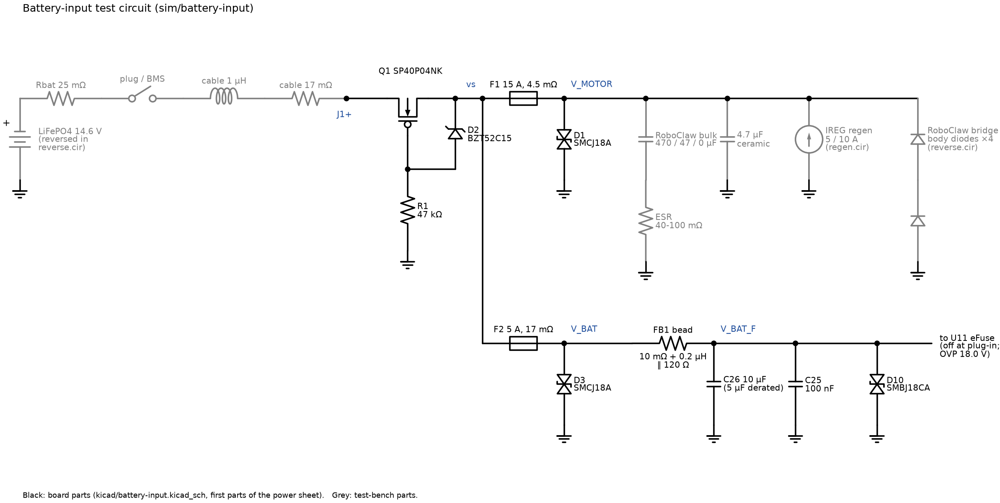
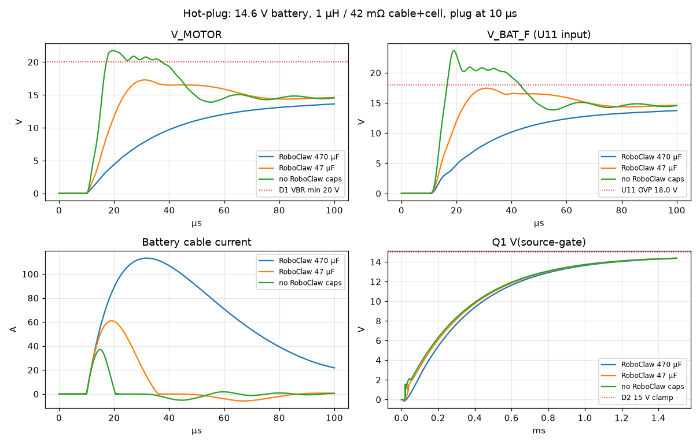
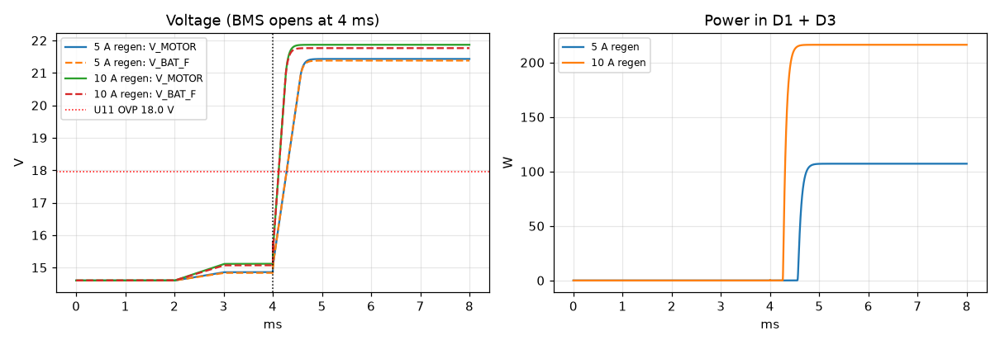
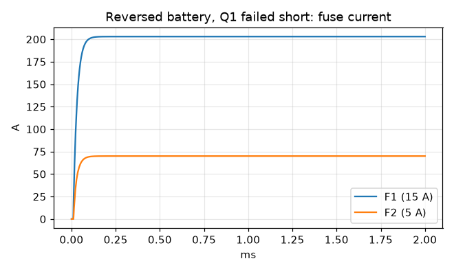

# Battery input: ngspice analysis

This note covers what the battery input stage does under three stresses:
- plugging in a fully charged battery;
- motor braking (regen), including the battery's BMS disconnecting mid-brake;
- connecting the battery backwards.

The input stage is in `kicad/battery-input.kicad_sch`. The simulation files,
models and raw results are in [battery-input/](battery-input/); see its
[README](battery-input/README.md) for how to re-run them.

## The circuit

Black parts are on the board. Grey parts are test-bench additions: the
battery, its cable, a switch for plug-in and BMS disconnect, the braking
current, and the RoboClaw's input capacitance and bridge diodes.

**Reverse-polarity switch (Q1, R1, D2).**
- Q1 is a P-channel MOSFET (SP40P04NK, 40 V, 4.9 mΩ) with its drain on J1+.
- With the battery the right way round:
  - Q1's body diode conducts first and lifts the source.
  - R1 (47 kΩ) holds the gate at ground, so the source-gate voltage rises
    until the MOSFET conducts on its own.
  - From then on Q1 conducts in both directions, so braking current can
    flow back into the battery.
- With the battery reversed, the gate can't go negative of the source, the
  body diode is reverse-biased, and Q1 blocks.
- D2 (15 V zener) clamps the source-gate voltage. It protects Q1's ±20 V
  gate rating when the rail is pushed up by a transient.

**Fuses.** The source of Q1 (node `vs`) splits into two fused branches:
- F1 (15 A) feeds `V_MOTOR`, the RoboClaw's battery input.
- F2 (5 A) feeds `V_BAT`, the logic supply branch.

**Surge clamps.** Each branch has an SMCJ18A TVS diode to PGND: D1 on
V_MOTOR, D3 on V_BAT. Both start conducting at 20–22 V.

**Logic input.** FB1 (ferrite bead) feeds `V_BAT_F`, which has:
- C26 (10 µF) and C25 (100 nF);
- D10, a second TVS diode (SMBJ18CA, conducts in both directions);
- the U11 eFuse input.

U11 is held off by its UVLO/soft-start when the battery is first connected.
Its overvoltage cutoff (OVP) is set by R27/R30 to
1.21 V × 193k/13k ≈ **18.0 V** (17.5–18.7 V with tolerances). Above that,
it cuts the 5 V supply.

### Assumptions

| Item | Value used |
|---|---|
| Battery | 14.6 V (full charge), 25 mΩ including the BMS |
| Cable | 1 m of 14 AWG pair: 1 µH, 17 mΩ |
| Fuse cold resistance | 4.5 mΩ (15 A), 17 mΩ (5 A) |
| C26 | 10 µF derated to 5 µF for DC bias |
| RoboClaw input capacitance | Not published; tested at 470 µF, 47 µF and none |

These LCSC parts have no vendor SPICE models. The models are fitted to
datasheet numbers, so treat the results as trends and margins, not exact
values.

## Hot-plug

**The test:** a full battery is connected at 10 µs. Each panel shows all
three RoboClaw-capacitance cases:

| Panel | What it shows |
|---|---|
| V_MOTOR (top left) | The motor rail. The dotted line marks where D1 starts to clamp (20 V). |
| V_BAT_F (top right) | The logic input at U11. The dotted line is U11's OVP threshold (18.0 V). |
| Battery cable current (bottom left) | The inrush current through the cable. |
| Q1 source-gate (bottom right) | How Q1 turns on over the next 1.5 ms. The dotted line is D2's 15 V clamp. |

| RoboClaw input caps | V_MOTOR peak | V_BAT_F peak | Inrush peak | TVS current |
|---|---|---|---|---|
| 470 µF | 14.6 V (no overshoot) | 14.6 V | 113 A | none |
| 47 µF | 17.3 V | 17.4 V | 61 A | none |
| none | 21.8 V | 23.7 V | 37 A | D1/D3 4.6 A, D10 3 A, a few µs |

**Large capacitance (470 µF):** the cable inductance and capacitor form a
heavily damped circuit.
- The rail rises smoothly to 14.6 V over about 100 µs.
- The capacitors draw a large but brief current: 113 A peak, mostly gone
  within 100 µs.

**Small or no capacitance:** the same inductance rings with the board's few
µF of ceramic capacitance.
- With 47 µF, the peak stays below the TVS threshold.
- With no RoboClaw capacitance:
  - The rail reaches about 22 V, and the TVS diodes clip it for a few µs at
    a few amps, well inside their ratings.
  - V_BAT_F peaks at 23.7 V, above U11's OVP threshold. That doesn't matter,
    because U11 is still held off at plug-in.

**Q1 turn-on:** in every case, the source-gate voltage rises as the gate
discharges through R1. Q1 is fully on (more than 8 V) about 0.3 ms after plug-in and
settles at 14.4 V, just under D2's clamp. Until then the body diode carries
the inrush, a short pulse well within its rating.

## Regen with the BMS opening

**The test:** the RoboClaw starts returning braking current at 2 ms,
ramping to 5 A or 10 A by 3 ms. At 4 ms the BMS disconnects the battery.
It can do that on charge overcurrent, when a cell is full, or when it's
too cold to charge (see [Battery limits](#battery-limits-crius12-bms)).
- **Left panel:** V_MOTOR (solid) and V_BAT_F (dashed), with U11's OVP
  threshold.
- **Right panel:** the power dissipated in D1 and D3 together.

| Braking current | Rail with battery connected | Rail after BMS opens | D1 + D3 power |
|---|---|---|---|
| 5 A | 14.9 V | 21.4 V | 107 W |
| 10 A | 15.1 V | 21.9 V | 217 W |

**While the battery is connected:** Q1 passes the braking current straight
back into the battery, and the rail rises by only 0.3–0.5 V. This is the
point of using a MOSFET rather than a diode for reverse-polarity
protection: braking costs nothing.

**When the BMS opens,** the current has nowhere to go:
- It charges the RoboClaw's capacitors until D1 and D3 start conducting at
  about 21–22 V, and they then hold the rail there.
- That voltage is safe for the RoboClaw (34 V maximum) and for Q1.
- D2 holds Q1's source-gate voltage at 14.9 V.
- **But** the TVS diodes are now dissipating 100–200 W continuously. They're
  rated for short surges (about 1500 W for 1 ms), not continuous power, so
  sustained braking into an open battery will destroy them within
  milliseconds to seconds.
- V_BAT_F follows the rail to about 21.5 V, past U11's 18 V cutoff, so U11
  shuts off the 5 V supply and the CM4 loses power.

## Reverse polarity

**The test:** the battery is connected backwards, in two cases.

**Q1 healthy:** no measurable current flows (nanoamps). Q1 blocks the full
reversed voltage, nothing on the board sees it, and no fuse blows. The
plot doesn't show this case because there's nothing to show.

**Q1 failed short (the plot):**
- The reversed battery drives current forward through D1, D3 and the
  RoboClaw's bridge diodes.
- About 273 A flows in total, settling within 0.2 ms: 203 A through F1 and
  70 A through F2. That's more than 13 times each fuse's rating, so both
  blow quickly.
- The battery BMS's short-circuit protection will probably open even
  sooner.

The fuses are the backup for a failed Q1, as the README describes.

## Battery limits (CRIUS12 BMS)

The battery manual is
[docs/LiFePO4_Lithium_Battery_CRIUS12_Manual_12Ah.pdf](../docs/LiFePO4_Lithium_Battery_CRIUS12_Manual_12Ah.pdf).
It gives operating limits but not the BMS's actual trip points (current
levels or timing). These limits decide how likely the regen case is:

| Spec | Value | Effect on this board |
|---|---|---|
| Maximum charging current | **6 A** | Braking current is charging current. 5 A of regen is at the limit and 10 A is well over it, so the BMS may cut charging. |
| Charging voltage | 14.4 V (14.6 V max) | When the battery is full, braking current has to be refused, so the BMS may open. |
| Charging temperature | **0–50 °C** | The manual says not to charge below 0 °C. If the BMS enforces this, as many LiFePO4 BMSs do, braking current is blocked in freezing weather. |
| Maximum continuous discharge | 12 A (24 A for 5 s or less) | Below F1's 15 A rating. The worst-case load is about 9–10 A (5.5 A actuator, 1.8 A azimuth motor, about 2 A logic): within the limit, but not by much. |

So the BMS opening during braking isn't a rare fault. Three normal
conditions could cause it:
- braking above 6 A;
- braking with a full battery;
- braking below 0 °C, which a dish mounted outdoors will see.

## Assessment

Overall the input stage performs well. Its core jobs are reverse-polarity
blocking, clean hot-plug and passing braking current back to the battery.
In the simulations it does all three with wide margins:

- **Reverse polarity is handled properly.** A healthy Q1 blocks completely
  at almost no cost: 4.9 mΩ is about 1 W at 15 A. The fuses back it up if
  Q1 fails short. This is a much better arrangement than a series diode,
  which would waste about 10 W and block braking current.
- **Hot-plug is safe in every case simulated.** Even with no RoboClaw
  capacitance, the worst overshoot (23.7 V) is clamped well below the 34 V
  and 40 V ratings. Q1's gate never exceeds 15 V.
- **Braking current gets back to the battery** with only about 0.5 V of
  rise.

The weak point is regen when the battery disconnects. Given the battery's
limits above, this can happen in normal use. The circuit survives
the first milliseconds, but nothing on the board can absorb sustained
braking energy, and the CM4 drops out. I'd address it in this order:

1. **Set the RoboClaw's maximum battery voltage** below U11's 18 V cutoff,
   e.g. 16 V. When braking pushes the rail up, the RoboClaw then stops
   returning energy (see the RoboClaw manual's voltage settings). This is a
   configuration change and costs nothing.
2. **Keep braking current under the battery's 6 A charge limit.** Limit
   deceleration in software, especially for the elevation actuator, which
   the dish's weight can drive. That keeps braking under the BMS's charge
   limit. It doesn't help with a full battery or with temperatures below
   0 °C, which is why step 1 matters more.
3. **Ask GoldenMate for the BMS trip points:** the charge overcurrent level
   and delay, the full-charge behaviour, and whether it blocks charging
   below 0 °C. The manual doesn't list them, and they decide how often
   this case happens.
4. If the above aren't enough, add a dump circuit: a MOSFET and power
   resistor that switches across V_MOTOR above about 17 V. Check whether
   the RoboClaw manual offers a voltage-clamp output that can drive it.

Two smaller observations:
- **Spark at the connector.** The 113 A inrush (with large RoboClaw
  capacitance) will make a visible spark at J1. It's harmless to the
  circuit, but it will pit the connector contacts over many plug-ins.
- **Unknown RoboClaw capacitance.** The hot-plug results depend on it. If
  you can find or measure it, one case becomes the real one. Every case
  passes anyway, so this is about knowing the margin, not about a risk.
