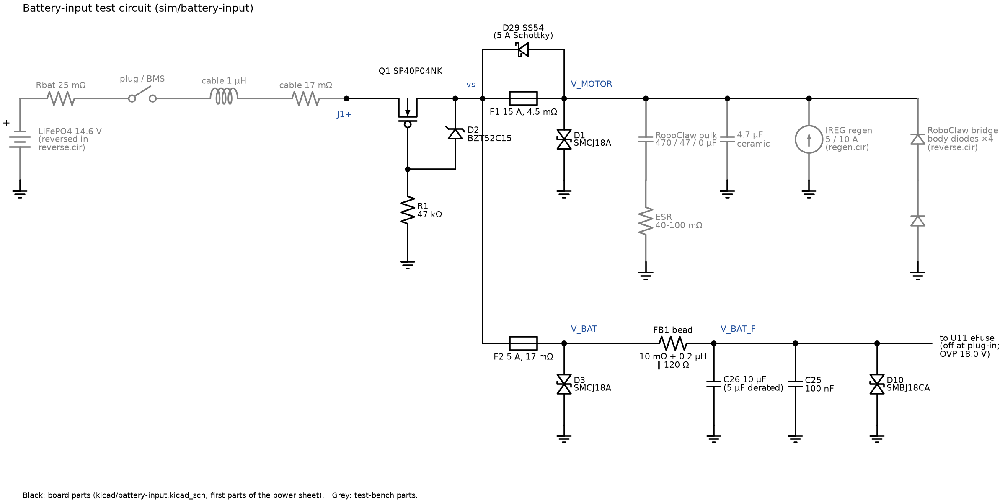

# Battery-input simulations (ngspice)

Test circuits for the battery input stage (`kicad/battery-input.kicad_sch`):
Q1 reverse-polarity P-MOSFET, D2/R1 gate network, F1/F2, D29 regen return
diode across F1, TVS diodes D1/D3, and the first parts on each output (RoboClaw input capacitance on V_MOTOR;
FB1, C25/C26 and D10 on V_BAT_F ahead of the U11 eFuse).

```sh
brew install ngspice
./run.sh                 # writes results/*.log and results/*.dat
python3 plot.py          # needs matplotlib; writes results/*.png
python3 circuit.py       # needs schemdraw; writes results/circuit.png
```



| File | Contents |
|---|---|
| `models.lib` | Behavioural models fitted to datasheet numbers (no vendor models exist for these LCSC parts) |
| `board.inc` | The input stage netlist, shared by every test |
| `hotplug.cir` | Fully charged battery (14.6 V) plugged in through 1 µH of cable |
| `regen.cir` | Braking current returned to V_MOTOR, with F1 intact and with F1 open (D29 path), then the battery BMS opens |
| `reverse.cir` | Battery reversed: Q1 healthy, Q1 failed short, and Q1 failed short with F1 open |
| `circuit.py` | Draws the circuit above (black: board parts, grey: test-bench parts) |

Assumptions: battery + BMS 25 mΩ; 1 m of 14 AWG pair (1 µH, 17 mΩ);
ATO fuse cold resistance 4.5 mΩ (15 A) and 17 mΩ (5 A); C26 derated to 5 µF;
D29 (SS54) fitted to the MDD datasheet's typical curve, 0.46 V at 5 A and
0.58 V at 10 A. The RoboClaw's input capacitance is not published, so `hotplug` runs
470 µF, 47 µF and none. The results show trends, not exact values.

## Results

**Hot-plug** (`results/hotplug.png`)

| RoboClaw input caps | V_MOTOR peak | V_BAT_F peak | Cable peak | TVS current |
|---|---|---|---|---|
| 470 µF | 14.6 V (no overshoot) | 14.6 V | 113 A | none |
| 47 µF | 17.3 V | 17.4 V | 61 A | none |
| none | 21.8 V | 23.7 V | 37 A | 4.6 A (D1), 3 A (D10), brief |

- Every case stays far below Q1's 40 V and the RoboClaw's 34 V rating.
- U11 is still held off when the battery is first connected, so the 23.7 V
  spike does not trip its OVP.
- Q1's source-gate voltage rises through R1 over about 1 ms and settles at
  14.4 V, under D2's 15 V clamp. Until the channel turns on, Q1's body diode
  carries the inrush current.
- The 113 A peak lasts tens of µs, a tiny I²t compared with an ATO fuse. It
  will make a spark at the connector.
- D29 is reverse-biased throughout (under 30 µA); the hot-plug results are
  the same with or without it.

**Regen with the BMS opening** (`results/regen.png`)

| Braking current | V_MOTOR before | V_MOTOR after BMS opens | D1 + D3 power |
|---|---|---|---|
| 5 A | 14.9 V | 21.4 V | 107 W |
| 10 A | 15.1 V | 21.9 V | 217 W |

- With the battery connected, Q1 returns the braking current and the rail
  rises by only about 0.5 V.
- If the BMS opens, D1 and D3 clamp the rail at about 21–22 V. That is safe
  for the RoboClaw, but at 100–200 W the TVS diodes can only absorb it for
  milliseconds. Sustained regen into an open battery will destroy them.
- V_BAT_F follows the rail above U11's OVP threshold
  (1.21 V × 193k/13k ≈ 18.0 V), so U11 disconnects the 5 V supply and the
  CM4 loses power.
- With F1 intact, D29 never conducts (its 45 mV of bias is far below its
  forward drop).

**Regen with F1 open** (`results/regen_f1open.png`)

| Braking current | V_MOTOR before | D29 current, power | V_MOTOR after BMS opens | D1 + D3 power |
|---|---|---|---|---|
| 5 A | 15.3 V | 5.0 A, 2.3 W | 21.6 V | 108 W |
| 10 A | 15.6 V | 10 A, 5.8 W | 22.1 V | 220 W |

- With F1 open, all of the braking current returns to the battery through
  D29. The rail rises by D29's forward drop, 0.5–1 V more than with F1
  intact, and stays below U11's OVP, so the CM4 keeps running.
- After the BMS opens the outcome is the same as with F1 intact: D1 and D3
  clamp the rail at 21.6–22.1 V. D29 then carries only the 1.4–3.6 A that
  reaches D3.
- D29 is rated 5 A average and 60 °C/W junction-to-ambient. 2.3 W at 5 A
  is more than it can shed continuously; the datasheet's transient thermal
  impedance (about 20 °C/W at 1 s) makes a 1 s stop at 5 A a 45 °C rise and
  at 10 A about 115 °C. It is a transient return path, not a continuous one.

**Reverse polarity** (`results/reverse.png`)

- Q1 healthy: no current flows (nA).
- Q1 failed short: about 275 A flows through D1, D3, D29 and the RoboClaw's
  bridge diodes. That is 186 A in F1, 22 A in D29 beside it and 67 A in F2,
  more than 12× each fuse's rating, so both fuses blow quickly. The battery
  BMS's short-circuit protection will probably open first.
- Q1 failed short, F1 open: D29 alone carries the motor branch, 104 A, with
  137 A in F2. That is close to the SS54's 120 A single-pulse surge rating,
  so D29 fails within milliseconds. If it fails short, the motor branch is
  unfused until the battery's own protection opens.
