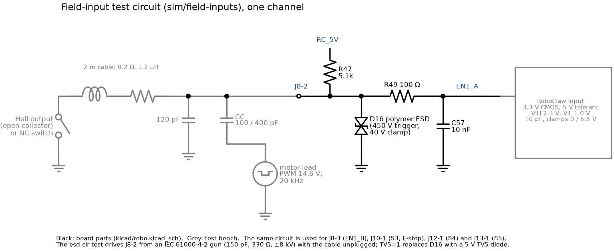
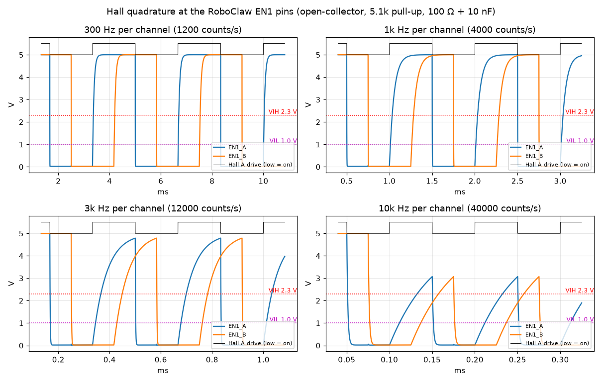
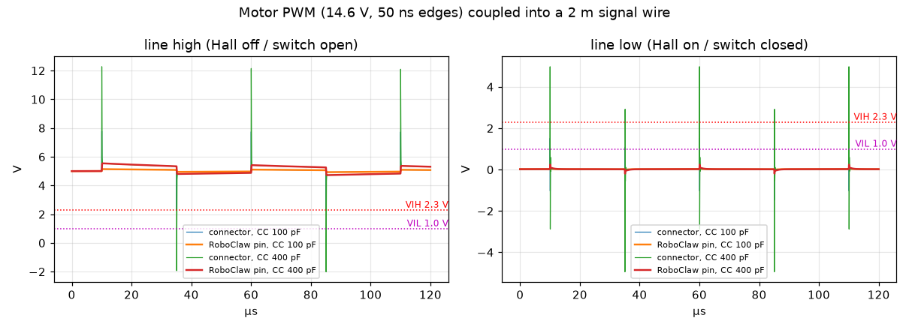
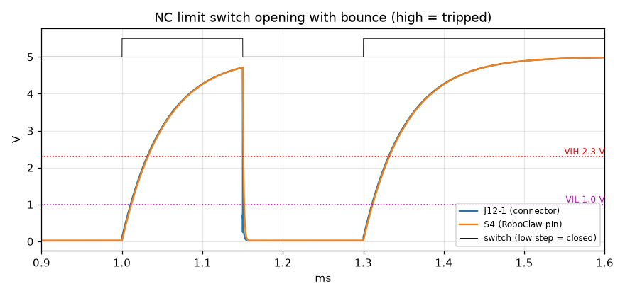
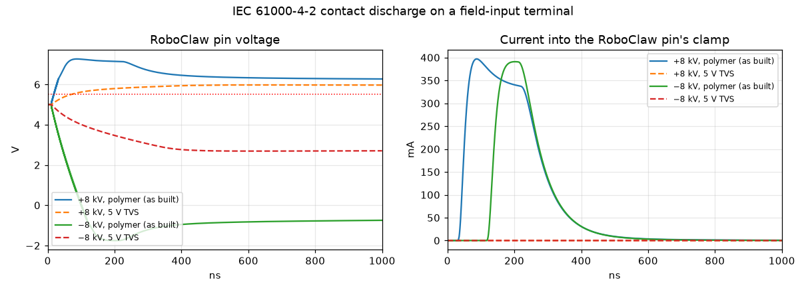

# Field inputs: ngspice analysis

This note covers the six RoboClaw inputs that run out to the dish on field
cables:
- the elevation actuator's Hall encoder (J8 to EN1_A/EN1_B);
- the E-stop (J10 to S3);
- the elevation and azimuth limit switches (J12 to S4, J13 to S5).

It asks four questions:
- Do the Hall pulses get through cleanly at speed?
- Can motor PWM noise cause false edges?
- How fast does a limit trip register?
- What reaches the RoboClaw when someone discharges static into a terminal?

The simulation files are in [field-inputs/](field-inputs/); see its
[README](field-inputs/README.md) for how to re-run them.

## The circuit

All six inputs use the same circuit (`kicad/robo.kicad_sch`):
- **Pull-up:** 5.1k to the RoboClaw's 5 V output (RC_5V). This suits
  open-collector Hall outputs and normally-closed switches to ground.
- **ESD part:** a TPESD0402G12V at the terminal. This is a *polymer* ESD
  suppressor, not a TVS diode. It has almost no capacitance (0.05 pF) but
  doesn't conduct until about 450 V, then clamps near 40 V.
- **Filter:** 100 Ω in series and 10 nF to ground at the RoboClaw pin.

**Two things about how the circuit behaves:**
- **Edge speed depends on direction.** A Hall output or switch pulling the
  line low discharges the 10 nF through 100 Ω: a 1 µs time constant. Going
  high, the 5.1k pull-up has to charge the 10 nF, and the time constant is
  **51 µs**.

  > **Note:** the Motor Notes sheet describes the filter as "tau = 1 us,
  > about 160 kHz". That's true only for falling edges.
- **The RoboClaw manual** says its inputs are 3.3 V logic, protected
  "against signals up to 5 V" by internal current limiting and clipping.
  It doesn't give thresholds or clamp ratings. I've assumed CMOS levels of
  2.3 V (high) and 1.0 V (low), and clamps at 0 and 5.5 V.

Treat the results as margins, not exact numbers.

## Hall edges at speed

**The test:** the Hall outputs are open-collector, at the far end of 2 m of
cable, switching in quadrature. They're run at 300 Hz, 1 kHz, 3 kHz and
10 kHz per channel. Each plot shows EN1_A and EN1_B at the RoboClaw, with
its thresholds, and Hall A's drive along the top.

| Per channel | Counts/s | Rising delay | Falling delay | Closest A/B edges | Nominal | Kept |
|---|---|---|---|---|---|---|
| 300 Hz | 1,200 | 33.8 µs | 2.2 µs | 802 µs | 833 µs | 96 % |
| 1 kHz | 4,000 | 32.3 µs | 2.2 µs | 220 µs | 250 µs | 88 % |
| 3 kHz | 12,000 | 32.4 µs | 2.0 µs | 53 µs | 83 µs | 63 % |
| 10 kHz | 40,000 | 32.3 µs | 1.6 µs | 6 µs | 25 µs | 23 % |

- **What fails:** the slow 32 µs rising edge eats into the quarter-period
  between A and B edges.
- **Where it fails:**
  - Up to about 1 kHz per channel, the quadrature stays clean.
  - At 3 kHz it still decodes, with less margin.
  - At 10 kHz the line doesn't even reach 5 V before it's pulled low again,
    and A and B edges nearly collide.
- **What the actuator needs:**
  - The Firgelli actuator moves at about 6 mm/s with no load. Firgelli
    doesn't publish its pulses per mm.
  - Reaching 1 kHz would take about 170 pulses per mm, far more than any
    actuator Hall sensor provides, so there is a lot of margin.
  - Once you know the actuator's real count rate (the RoboClaw's QPPS
    setting), you can read the margin directly off this table.

## Motor PWM noise

**The test:** the actuator's motor leads run in the same cable as its Hall
wires. The motor lead swings 0 to 14.6 V with 50 ns edges, and couples into
the signal wire through 100 pF (typical) or 400 pF (pessimistic) of
capacitance spread along the cable.

- **Left panel:** line high (Hall off, or switch open).
- **Right panel:** line low (Hall on, or switch closed).

**At the connector** the spikes are large: up to 12 V and down to −5 V.

**At the RoboClaw pin** the 100 Ω + 10 nF filter cuts them to almost
nothing:

| Line state | Pin range with 400 pF | Threshold | Margin |
|---|---|---|---|
| High | 4.72 to 5.54 V | 2.3 V | more than 2.4 V |
| Low | −0.20 to +0.24 V | 1.0 V | about 0.8 V |

No false edges are possible.

## Limit and E-stop switches

**The test:** a normally-closed switch at the end of 2 m of cable opens
(trips) at 1.00 ms, with a contact bounce. It re-closes from 1.15 ms to
1.30 ms, then opens for good.

- **Trip delay:** the RoboClaw input reads tripped **32 µs** after the
  contact opens. That's negligible against the speed of a dish axis.
- **Bounce:** the input follows the bounce. It clears when the contact
  re-closes, then trips again. That's harmless for limits.
  - For the E-stop, use the RoboClaw's *E-Stop (Latching)* mode, so a bounce
    can't release a stop once it's triggered.
  - As the schematic notes, all three inputs need the RoboClaw's **Invert
    (active-high)** setting, because the switches are normally closed.
- **Fail-safe:** a broken wire looks like an open switch, so it reads as
  tripped.

## ESD on a terminal

**The test:** an IEC 61000-4-2 contact discharge, ±8 kV, onto a terminal
with the cable unplugged. That's what a person handling the field wiring
can deliver. It's run with the board as built (polymer suppressor) and with
a 5 V TVS diode in its place.

- **Left panel:** the voltage at the RoboClaw pin.
- **Right panel:** the current forced into the pin's internal clamp.

| | As built (polymer) | 5 V TVS instead |
|---|---|---|
| Terminal, while clamped | about 63 V | 17 V (+8 kV), −11 V (−8 kV) |
| RoboClaw pin | 7.3 V / −1.75 V | 2.7 to 6.0 V |
| Current into the pin's clamp | **about 0.4 A for about 250 ns** | essentially none |

**As built:**
- The polymer part does trigger, but it holds the terminal at tens of
  volts.
- The 100 Ω + 10 nF filter then soaks up most of the energy, which keeps
  the pin to 7.3 V.
- But the RoboClaw pin's own protection still takes about 0.4 A. The
  manual only promises protection "up to 5 V", so whether 0.4 A for
  250 ns is safe is unknown. Many microcontroller inputs survive it;
  that's not a guarantee.

**With a 5 V TVS diode,** the terminal is clamped at 17 V or less, and the
filter keeps the pin inside its supply range. Nothing flows into the
RoboClaw.

## Assessment

The input design is sound for its main job:
- **Noise immunity is excellent:** more than 2.4 V and 0.8 V of margin with
  pessimistic coupling from the motor leads.
- **Limit and E-stop trips register in 32 µs,** and a broken wire reads as
  tripped.
- **The Hall inputs handle up to about 1 kHz per channel cleanly,** far
  above anything the actuator can produce.

Things I'd change or act on:

1. **Replace the polymer ESD parts on the field inputs with 5 V TVS
   diodes.** That's D16–D20.
   - The polymer TPESD0402G12V is designed for high-speed data lines,
     where low capacitance matters most. Its 450 V trigger and 40 V clamp
     leave the RoboClaw pin to absorb about 0.4 A per strike.
   - A 5 V unidirectional TVS (a few hundred pF is fine behind a 5.1k
     pull-up) keeps the pin within its supply with no clamp current.
   - The parts are 0402-sized on the board now, so this needs a footprint
     check.
   - D22 on the AS5600 analog input is a special case. That line has a
     high-impedance divider, so a replacement there needs low leakage at
     3.3 V. A typical 5 V TVS leaking 1 µA would shift the reading by
     about 40 mV.
2. **Fix the Motor Notes text.** The rising edge of the Hall and switch
   inputs has a 51 µs time constant (5.1k × 10 nF), not 1 µs. It doesn't
   affect operation at the actuator's speeds, but the note is misleading.
3. **Set the RoboClaw inputs correctly in Motion Studio:**
   - S3, S4 and S5 to Invert (active-high);
   - the E-stop to E-Stop (Latching).

Not simulated: a larger series resistor (e.g. 1k instead of 100 Ω) would
also cut the ESD clamp current, at the cost of slower falling edges. The
TVS change is the cleaner fix.
