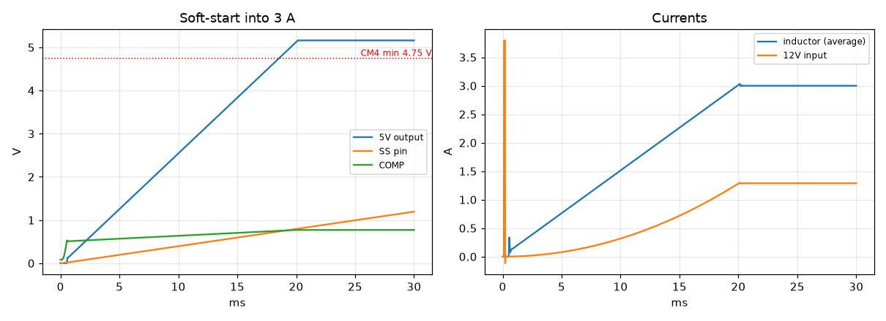
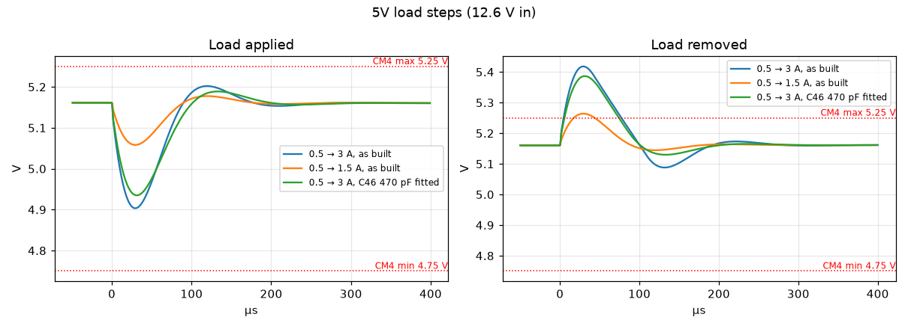
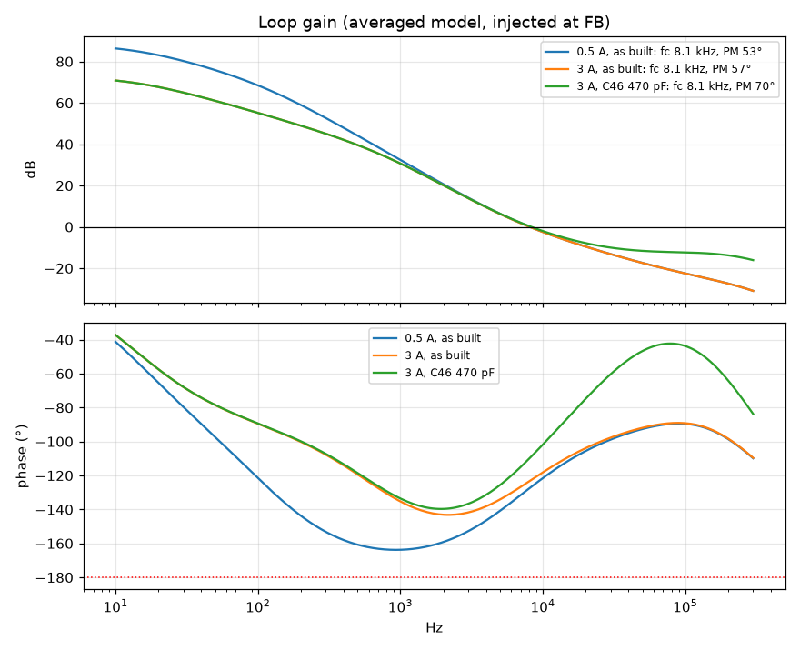
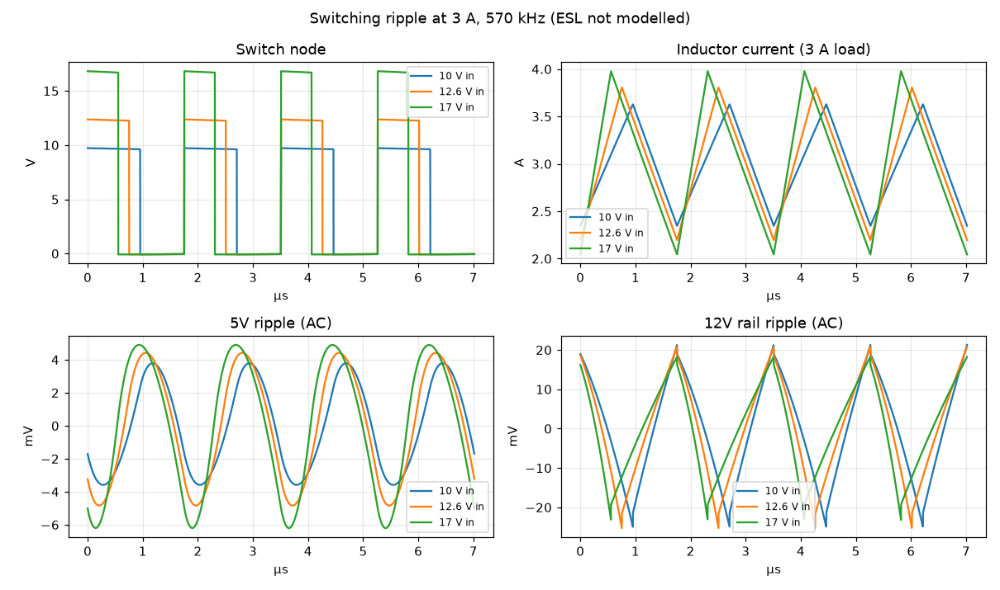

# 5 V buck: ngspice analysis

This note covers the 5 V supply on `kicad/power_5v.kicad_sch`: U15, an
AP64501 synchronous buck that turns the 12V rail into 5.16 V for the CM4 and
the USB ports. It looks at:
- start-up;
- load steps;
- control-loop stability;
- switching ripple.

The simulation files are in [power-5v/](power-5v/); see its
[README](power-5v/README.md) for how to re-run them. What feeds the 12V
rail is covered in [power.md](power.md).

## The circuit

**U15 (AP64501)** switches at 570 kHz. It uses peak-current-mode control:
the COMP voltage sets the peak inductor current each cycle.

| Function | Parts | Value |
|---|---|---|
| Output voltage | R42 12k / R44 2.2k (0.1 %) | 0.8 V × (1 + 12k/2.2k) = 5.16 V |
| Compensation | R43 20k + C56 1.2 nF on COMP | zero at 6.6 kHz |
| Optional (DNP) | C46 across R42, C55 on COMP | feedforward; high-frequency pole |
| Soft-start | C54 100 nF | 4 µA × 100 nF / 0.8 V gives 20 ms |
| Enable | R65 100k from 12V to EN | starts automatically |
| Inductor | L2 SRP7028A-3R3M | 3.3 µH, 30 mΩ, saturates at 12 A |
| Output capacitors | C41–C44 4 × 10 µF ceramic, C45 100 µF polymer (15 mΩ), C5/C6 at the CM4 | |
| Input capacitors | C47 100 nF, C48–C53 6 × 10 µF | |

The CM4 needs 4.75–5.25 V. Its absolute maximum is 6.0 V.

**Two models are used:**
- **Averaged model** (start-up, load steps, loop gain). It's built from the
  datasheet's control constants:

  | Constant | Value |
  |---|---|
  | Error amplifier gm | 0.15 mS |
  | Current-sense gain | 0.089 V/A |
  | Reference | 0.8 V |
  | Soft-start current | 4 µA |
  | Switch resistance | 45 / 20 mΩ |

  It's accurate up to about 100 kHz. It doesn't model PFM, the AP64501's
  power-saving pulse mode at light load (below roughly 0.8 A here).
- **Switching model** (ripple). This is the power stage on its own, at a
  fixed duty cycle.

Ceramic capacitors are derated for DC bias. Capacitor ESL isn't modelled.

## Start-up

**The test:** the 12V rail comes up at 0.1 ms with a 3 A load on 5V.

**Left panel:**
- The SS pin charges at 4 µA. The error amplifier follows it until it
  passes 0.8 V, so the output rises linearly.
- 5V reaches 5.1 V at **19.9 ms**, with no overshoot.
- COMP stays well inside its range.

**Right panel:**
- The inductor current rises with the output.
- The 12V input current climbs smoothly to 1.3 A.
- The brief 3.8 A spike at 0.1 ms is the test source charging the input
  capacitors, not the buck. This is the same inrush that the
  [power-sheet SW1 test](power.md#sw1-switched-on) looks at.

## Load steps

**The test:** a 0.5 A base load with a step added at 2 ms and removed at
4 ms. Each step has a 1 µs edge.
- **Left panel:** the dip when the load is applied.
- **Right panel:** the overshoot when it's removed.
- Dotted lines mark the CM4's 4.75–5.25 V window.

| Step | Dip | Overshoot | Time above 5.25 V |
|---|---|---|---|
| +2.5 A (to 3 A), as built | 4.90 V | 5.42 V | about 70 µs |
| +1 A (to 1.5 A), as built | 5.06 V | 5.26 V | 25 µs |
| +2.5 A, C46 470 pF fitted | 4.93 V | 5.39 V | about 67 µs |

**Load applied:** the dips stay well above 4.75 V.

**Load removed:** the overshoots break the 5.25 V limit. The cause is the
setpoint, not the loop:
- 5.16 V leaves only 90 mV of headroom.
- That setpoint was chosen so USB VBUS stays above 4.75 V after U4's
  voltage drop (see the note on the Power_5V sheet).
- Any load release larger than about 0.9 A crosses 5.25 V briefly.

The overshoots stay far below the CM4's 6.0 V absolute maximum and last
tens of microseconds.

## Loop stability

**The test:** the loop gain, measured by injecting a small signal at the FB
pin. The plot shows gain (top) and phase (bottom). The crossover frequency
(fc) is where the gain crosses 0 dB. The phase margin (PM) is how far the
phase is from −180° at that point.

| Case | Crossover | Phase margin |
|---|---|---|
| 0.5 A, as built | 8.1 kHz | 53° |
| 3 A, as built | 8.1 kHz | 57° |
| 3 A, C46 470 pF fitted | 8.1 kHz | 70° |

**As built:**
- Crossover at 8.1 kHz is 1.4 % of the switching frequency. The datasheet
  asks for less than 10 %, so this is conservative.
- 53–57° of phase margin is a healthy design, with the well-damped load
  response seen above.
- At 0.5 A the phase dips to about −163° near 1 kHz, but the gain is
  40 dB there, so it doesn't matter.

**With C46 fitted:** C46 adds a phase boost near crossover, raising the
margin to 70°. It barely changes the load-step peaks, which are set by the
output capacitance and the crossover frequency.

**Limitation:** the averaged model approximates the current loop's
high-frequency behaviour, so the gain margin isn't reliable. The phase
margin at 8 kHz is.

## Switching ripple

**The test:** the power stage switching at 570 kHz with a 3 A load, at 10,
12.6 and 17 V input. The panels show the switch node, the inductor current,
and the AC ripple on 5V and on the 12V rail.

| Input | Inductor ripple | Inductor peak | 5V ripple | 12V rail ripple | Input-cap RMS | C45 RMS |
|---|---|---|---|---|---|---|
| 10 V | 1.28 A p-p | 3.63 A | 7.4 mV p-p | 46 mV p-p | 1.51 A | 0.17 A |
| 12.6 V | 1.61 A p-p | 3.81 A | 9.3 mV p-p | 46 mV p-p | 1.49 A | 0.21 A |
| 17 V | 1.93 A p-p | 3.98 A | 11.1 mV p-p | 41 mV p-p | 1.38 A | 0.25 A |

- **Inductor:** the ripple matches the design note on the sheet (1.56 A at
  12 V). The peak current is a third of L2's 12 A saturation rating and
  well under U15's 6.8 A minimum current limit.
- **5V output:** 7–11 mV p-p of switching ripple is very low, thanks to the
  polymer C45. ESL isn't modelled, so the real waveform will also have
  narrow spikes at each switching edge. Good layout keeps those small.
- **Input capacitors:** about 1.5 A RMS shared across six capacitors is
  about 0.25 A each, comfortably within the rating of a 0805 X7S/X6S part.

## Assessment

The 5 V buck is a solid design:

- **Start-up** is smooth and monotonic, as the CM4 requires ("+5V should
  rise monotonically to 4.75V"). It has no overshoot and no input surge
  beyond the load current.
- **The control loop** is well compensated: 8 kHz crossover with 53–57°
  phase margin at light and full load.
- **Ripple and component stress** are all comfortably inside ratings, with
  very low output ripple.

**The one weakness is the narrow 90 mV gap between the 5.16 V setpoint and
the CM4's 5.25 V limit.** Releasing a load step of more than about 0.9 A
briefly exceeds 5.25 V: 5.26 V for 25 µs after 1 A, and 5.42 V for 70 µs
after 2.5 A. These are short, far below the 6.0 V absolute maximum, and
unlikely to cause trouble. Large load releases on 5V mostly come from
unplugging a busy USB device.

If you want full compliance:
- **Lowest effort:** fit C46 (470 pF). It improves phase margin to 70° and
  trims the overshoot slightly. On its own it isn't enough.
- **More output capacitance helps only a little.** I simulated a second
  100 µF polymer next to C45:
  - the 2.5 A release peaks at 5.38 V instead of 5.42 V;
  - the 1 A release just stays inside, at 5.248 V.

  The reason is that extra capacitance also lowers the loop's crossover
  frequency. A real improvement would mean raising the crossover (R43 and
  C56) at the same time, which is a compensation redesign.
- **Lower setpoint:** about 5.10 V would add 60 mV of headroom, but it eats
  into the USB VBUS margin the setpoint was chosen for.

I'd leave the design as it is and revisit it only if bench testing shows
a problem.

**Not covered here:** PFM operation at light load. With 1.6 A of
inductor ripple, the AP64501 starts skipping pulses below roughly 0.8 A.
That includes the 0.5 A base load of the step tests, so the real response
from and to light load will differ somewhat from the averaged results.
Only a vendor model or bench measurement can show that.
