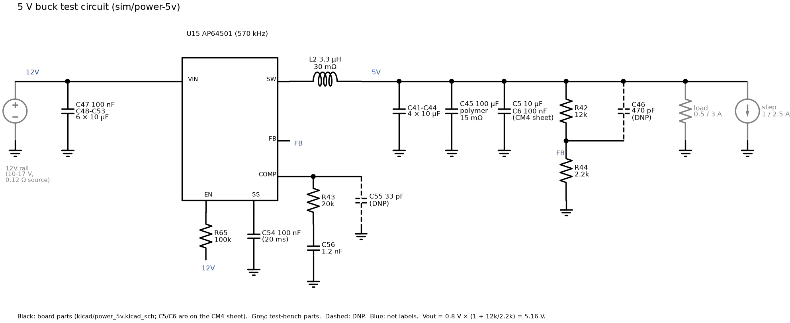

# 5 V buck simulations (ngspice)

Test circuits for the Power_5V sheet (`kicad/power_5v.kicad_sch`): the U15
AP64501 buck, which turns the 12V rail into 5.16 V for the CM4 and USB.
The write-up is [../power-5v.md](../power-5v.md).

```sh
brew install ngspice
./run.sh                 # writes results/*.log and results/*.dat
python3 plot.py          # needs matplotlib; writes results/*.png
python3 circuit.py       # needs schemdraw; writes results/circuit.png
```



| File | Contents |
|---|---|
| `models.lib` | `AP64501AVG`, an averaged peak-current-mode model of U15 |
| `board.inc` | The Power_5V netlist (averaged), shared by the averaged tests. The DNP parts C46 and C55 are parameters. |
| `startup.cir` | Soft-start into 3 A |
| `loadstep.cir` | 0.5 A base load with a 1 A or 2.5 A step, as built and with C46 fitted |
| `loop.cir` | Loop gain (AC) at 0.5 A and 3 A, as built and with C46 fitted |
| `ripple.cir` | Switching power stage at 570 kHz, 3 A, with 10, 12.6 and 17 V in |
| `c28ripple.cir` | As `ripple.cir`, with the 12V side modelled through C28 (EFUSE_OUT), Q2 and copper, to find C28's share of the input ripple. C28's ESR at 570 kHz isn't published, so it's swept from 0.1 to 1 Ω. |
| `circuit.py` | Draws the circuit above |

**What the averaged model uses from the datasheet:**

| Parameter | Value |
|---|---|
| Error amplifier gm | 0.15 mS (output resistance assumed 10 MΩ) |
| Current-sense gain RT | 0.089 V/A |
| Reference | 0.8 V |
| Soft-start | 4 µA into C54, giving 20 ms |
| High-side / low-side switches | 45 mΩ / 20 mΩ |
| Peak current limit | 8 A |
| UVLO, EN thresholds | from the datasheet |

The inner current loop is modelled as a 190 kHz first-order loop. That
stands in for the sampling effects of current-mode control, so the model
is good up to about 100 kHz. It doesn't model PFM at light load, spread
spectrum or the valley current limit. PFM starts below roughly 0.8 A here,
which includes the 0.5 A base load of the step tests.

**Other assumptions:**
- C41–C44 are derated to 6 µF each at 5 V.
- C45 has 15 mΩ ESR.
- C5 is derated to 6 µF, and C6 (100 nF) is included.
- The 12V rail feeds U15 through 0.12 Ω, the eFuse path.
- ESL isn't modelled, so the real ripple will also have switching spikes.

## Results

| Test | Result |
|---|---|
| Start-up | 5V reaches 5.1 V 19.9 ms after the 12V rail comes up, with no overshoot. The input current rises smoothly to 1.3 A. |
| Load step 0.5 → 3 A → 0.5 A | 4.90 V on the step up, **5.42 V** on release. The overshoot is above the CM4's 5.25 V operating limit for about 70 µs but below its 6.0 V absolute maximum. |
| Load step 0.5 → 1.5 A → 0.5 A | 5.06 V, then 5.26 V on release (above 5.25 V for 25 µs) |
| Load step, C46 470 pF fitted | 4.93 V, then 5.39 V on release |
| Loop gain | Crossover 8.1 kHz. Phase margin 53° at 0.5 A, 57° at 3 A, 70° with C46 fitted. |
| Ripple at 3 A, 10 / 12.6 / 17 V in | Inductor 1.3 / 1.6 / 1.9 A peak-to-peak, peaking at 3.6 / 3.8 / 4.0 A (L2 saturates at 12 A). 5V ripple 7–11 mV p-p. 12V rail ripple 41–46 mV p-p. Input capacitors carry 1.4–1.5 A RMS in total, C45 0.17–0.25 A RMS. |
| C28 ripple share | C28 carries 77 mA RMS at most (ESR 0.1 Ω, 10–12.6 V in), 30 mA at 0.3 Ω and 9 mA at 1 Ω. Its rating is 190 mA at 120 Hz, or 247 mA at 10 kHz and above. C48–C53 carry the rest, about 1.4–1.6 A RMS. |
