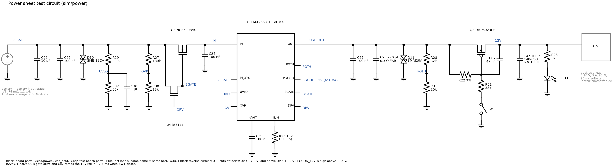
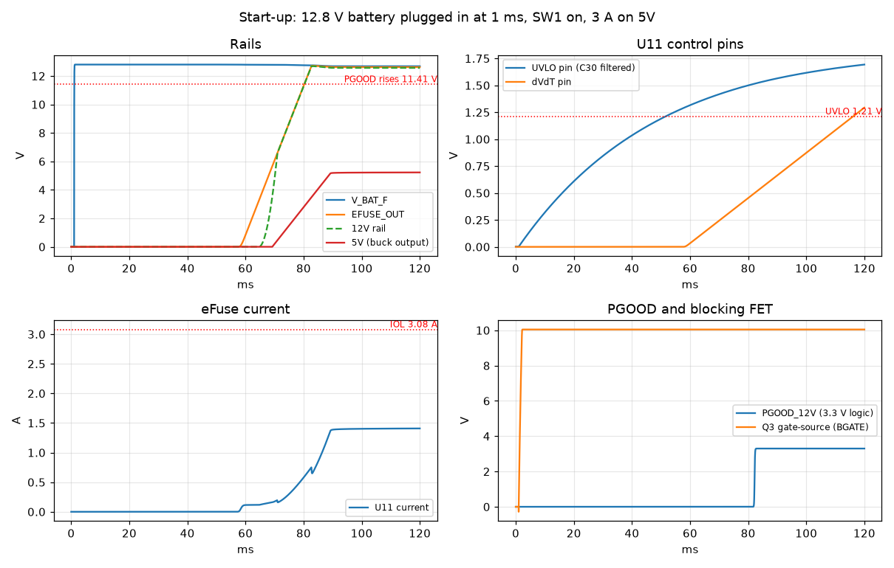
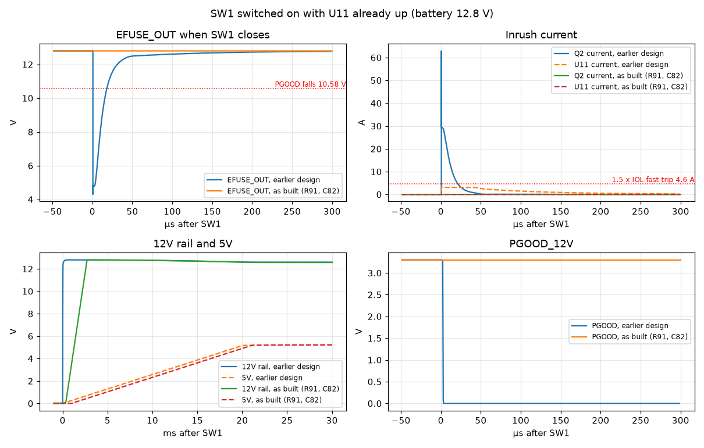
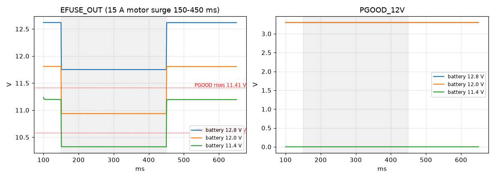
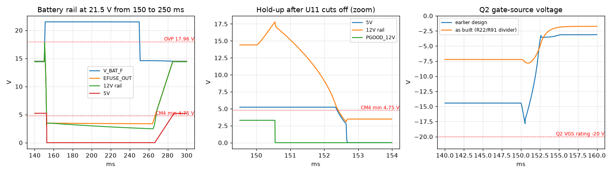

# Power sheet: ngspice analysis

This note covers the logic power path on `kicad/power.kicad_sch`, from the
filtered battery rail (V_BAT_F) to the 12V rail that feeds the 5 V buck. It
looks at four situations:
- plugging in the battery;
- switching SW1 on;
- a motor surge on a partly discharged battery;
- the battery rail rising above 18 V when braking current has nowhere to go.

The simulation files are in [power/](power/); see its
[README](power/README.md) for how to re-run them. The 5 V buck itself is in
[power-5v.md](power-5v.md).

## The circuit

**U11 (MX26631DL) eFuse.** It sits between V_BAT_F and EFUSE_OUT and:
- turns on only when V_BAT_F is above its undervoltage lockout (UVLO);
- cuts off above its overvoltage threshold (OVP);
- ramps its output at a controlled rate (dV/dt);
- limits current to 3.08 A;
- reports `PGOOD_12V` to the CM4.

| Setting | Parts | Value |
|---|---|---|
| UVLO | R29 330k / R32 56k, C30 1 µF filter | on at 8.34 V, off at 7.79 V |
| OVP | R27 180k / R30 13k | off at 17.96 V, back on at 16.78 V |
| PGOOD threshold, on EFUSE_OUT | R28 82k / R31 10k | high above 11.41 V, low below 10.58 V |
| Current limit | R26 13k | 3.08 A |
| Output ramp | C29 100 nF | 0.53 V/ms, about 24 ms to 12.6 V |

**Q3 and Q4: reverse-current blocking.**
- Q3 is an N-channel MOSFET between V_BAT_F and U11's input. U11 drives its
  gate (BGATE) 10 V above V_BAT_F.
- If the input drops below EFUSE_OUT, U11's DRV pin turns Q4 on, which
  shorts Q3's gate to its source within microseconds. EFUSE_OUT can then
  never feed current back into the battery side.

**SW1 and Q2: the power switch.**
- Q2 is a P-channel MOSFET from EFUSE_OUT to the 12V rail. R22 (33k) holds
  it off.
- SW1 pulls Q2's gate low through R91 (33k) to turn it on. R22 and R91 form
  a divider, so Q2's gate-source voltage is half of EFUSE_OUT.
- C82 (47 nF, gate to drain) makes Q2 turn on slowly, ramping the 12V rail
  instead of switching it hard.

**12V rail.** C47, C48–C53, the LED3 indicator and the U15 buck. Here U15 is
modelled as a load: 5.16 V at 3 A, 90 % efficient, with a 20 ms
soft-start.

### Assumptions

| Item | Value used |
|---|---|
| Source | Battery 25 mΩ, cable 17 mΩ and 1 µH, Q1 5 mΩ, F2 17 mΩ, FB1 9 mΩ. A 15 A motor surge flows through the shared battery and cable resistance. |
| C28 | 220 µF, 0.3 Ω ESR (assumed: the datasheet gives no ESR) |
| C26, C48–C53 | Derated for DC bias to about half their nominal value |
| U11 | Behavioural model built from the datasheet's thresholds, delays and current limit. It doesn't model thermal shutdown or the 1.5 × IOL fast trip. |

Treat the results as sequencing, thresholds and margins, not exact
waveforms.

## Start-up

**The test:** a full battery is plugged in at 1 ms with SW1 already on.

**Rails (top left):** V_BAT_F rises at once. EFUSE_OUT and the 12V rail
wait, then ramp together. The 5V output follows on its 20 ms soft-start.

**U11 control pins (top right):**
- The UVLO pin rises slowly, because C30 and the divider form a 48 ms
  filter. It crosses 1.21 V **50 ms** after plug-in.
- U11 adds its own 5.7 ms turn-on delay.
- The dVdT pin then ramps, and EFUSE_OUT follows at 25 times its voltage.

**eFuse current (bottom left):** it never comes near the 3.08 A limit.
- The output ramp charges C28 with only about 0.1 A.
- The rest is the buck starting up, which settles at 1.4 A.
- Q2 turns on once EFUSE_OUT is high enough for the R22/R91 divider to give
  it more than its 2 V gate threshold, then the 12V rail follows the ramp.

**PGOOD and blocking FET (bottom right):**
- Q3's gate reaches 10 V above V_BAT_F within about a millisecond of
  plug-in.
- PGOOD_12V goes high **81 ms** after plug-in, once EFUSE_OUT passes
  11.41 V and the 2 ms deglitch has passed.
- 5V is in regulation at **88 ms**.

## SW1 switched on

**The test:** the battery is connected with SW1 off, so U11 is up and
PGOOD is high. SW1 is then switched on at 150 ms. Each panel compares the
earlier design (SW1 straight to the gate, R22 100k, no C82) with the board
as built.

**Earlier design:**
- SW1 pulled Q2's gate straight to ground, so Q2 switched on in well under
  a microsecond.
- C28 then dumped into the discharged 12V rail capacitors. Q2's current
  peaked at **63 A** (top right), above its 50 A pulse rating.
- EFUSE_OUT collapsed to **4.3 V** (top left) and stayed below the PGOOD
  threshold for 17 µs, so PGOOD dropped for 2 ms (bottom right).
- The load asked U11 for far more than 1.5 × its current limit, so a real
  U11 would have fast-tripped and restarted, delaying start-up by up to
  about 0.7 s.

**As built (R22 33k, R91 33k, C82 47 nF):**
- C82 sets how fast Q2 can raise its drain. The 12V rail ramps at about
  5 V/ms and reaches 12 V in 2.6 ms.
- The surge is gone: the current never exceeds the 1.4 A load, EFUSE_OUT
  doesn't move, and PGOOD stays high.
- The values were chosen so Q2 stays off while EFUSE_OUT itself ramps up at
  start-up (the 12V rail stays at 20 mV with SW1 off). Q2 still gets
  −6.3 V of gate drive at 12.6 V, and about −5 V at a 10 V battery.

## Brownout: motor surge on a low battery

**The test:** the RoboClaw draws 15 A for 300 ms (shaded), pulling the
battery and cable down. It's repeated at three rested battery voltages.

**Left panel:** EFUSE_OUT, with PGOOD's rising (11.41 V) and falling
(10.58 V) thresholds marked.

**Right panel:** PGOOD_12V.

| Battery | EFUSE_OUT before | During the surge | PGOOD_12V |
|---|---|---|---|
| 12.8 V | 12.62 V | 11.75 V | stays high |
| 12.0 V | 11.81 V | 10.94 V | stays high |
| 11.4 V | 11.20 V | 10.32 V | never goes high |

**What this shows:**
- The surge costs about 0.9 V. UVLO (7.79 V) is never close, so the logic
  supply stays on.
- PGOOD_12V turns out to be a **low-battery signal**. It needs EFUSE_OUT
  above 11.41 V to go high, which means a battery above about 11.6 V under
  a 3 A logic load. It goes low if EFUSE_OUT falls below 10.58 V.
- For LiFePO4, about 11.6 V under load means the battery is nearly empty.
- The battery's BMS cuts out at about 10 V, before U11's UVLO. So
  PGOOD_12V is the only warning the CM4 gets before power disappears.

## Over-voltage (braking into an open battery)

**The test:** the battery rail is driven to 21.5 V from 150 ms to 250 ms.
That's where the TVS diodes hold it when the motors brake with the battery's
BMS open (see [battery-input.md](battery-input.md)). It then returns to
14.6 V.

**Left panel:** the whole event.

**Middle panel:** a zoom on the moment U11 cuts off.

**Right panel:** Q2's gate-source voltage, earlier design and as built.

**What happens:**
1. U11 cuts off within microseconds of V_BAT_F passing 17.96 V. Q3 and Q4
   stop C28 discharging back into the input.
2. EFUSE_OUT peaks at 17.8 V, so nothing downstream sees the 21.5 V.
3. The 12V rail and the buck run on C28 and the rail capacitors, but at
   17 W that energy lasts only **1.8 ms**. Then 5V drops below 4.75 V and
   the CM4 resets.
4. PGOOD drops the moment U11 cuts off, giving the CM4 1.8 ms of warning.
   That's too short to do anything useful.
5. When the rail falls back below 16.78 V, the 12V rail has collapsed, so
   U11 restarts with its slow ramp. 5V is back **35 ms** later.
6. **Q2's gate stays well inside its ±20 V rating.** With SW1 straight to
   the gate (earlier design), V_GS followed EFUSE_OUT to **−17.8 V**, and
   it would reach about −19 V at U11's 18.7 V worst-case cutoff. As built,
   the R22/R91 divider halves it: **−7.2 V** before the event and **−7.8 V**
   at the peak. EFUSE_OUT itself can't follow a fast surge, because U11's
   3.08 A limit into about 250 µF caps its slew at about 0.012 V/µs.

## Assessment

The power sheet does its protective job well:

- **Start-up is clean and well sequenced.** The eFuse current never
  approaches its limit, and the UVLO filter keeps U11 off while the battery
  connection settles. The roughly 88 ms from plug-in to 5V is fine for this
  application.
- **The protection thresholds are sensible.**
  - UVLO and OVP bracket the battery range (10–14.6 V) with margin.
  - OVP keeps everything after U11 below 18 V even with 21.5 V on the
    battery rail.
  - Q3 and Q4 block reverse current.
- **A motor surge doesn't disturb the logic supply** at any battery voltage
  the BMS allows.
- **SW1 switch-on is gentle.** R91 and C82 ramp the 12V rail in 2.6 ms with
  no inrush beyond the load current, and the R22/R91 divider keeps Q2's
  gate at half of EFUSE_OUT (−7.8 V at worst against ±20 V).

Things I'd change or act on, in order:

1. **Use PGOOD_12V in the CM4 software as a "battery nearly empty"
   warning.**
   - Start a clean shutdown when it has been low for more than a few
     seconds. Motor surges only pull it low briefly, and only on an
     already-low battery.
   - The BMS will cut power at about 10 V with no further warning.
2. **The OVP event resets the CM4.** That's the same braking-into-an-open-
   battery case as in [battery-input.md](battery-input.md). The fix belongs
   on the motor side: set the RoboClaw's maximum battery voltage below 18 V
   and keep braking current under the battery's 6 A charge limit. More hold-
   up capacitance on the 12V rail isn't practical: 1.8 ms at 17 W would need
   ten times the capacitance to reach even 20 ms.
