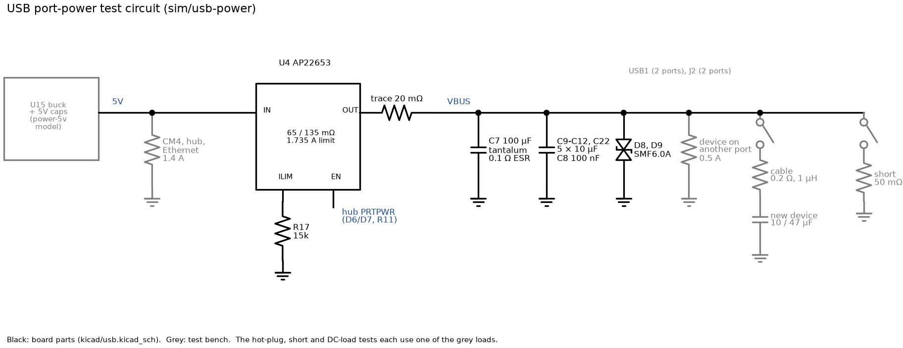
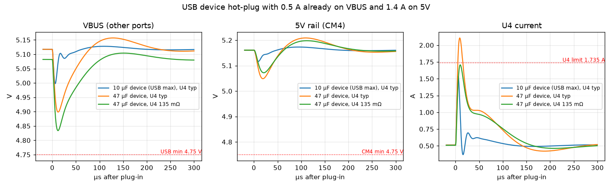
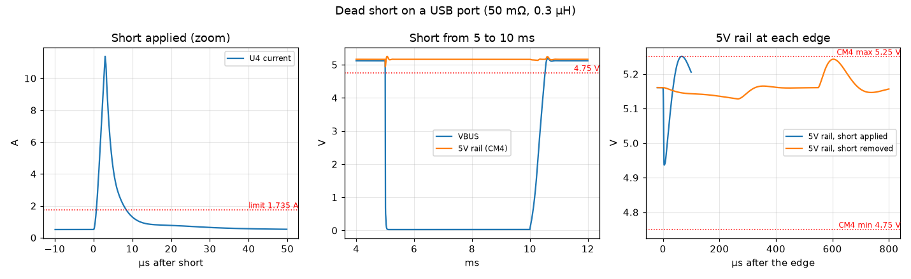
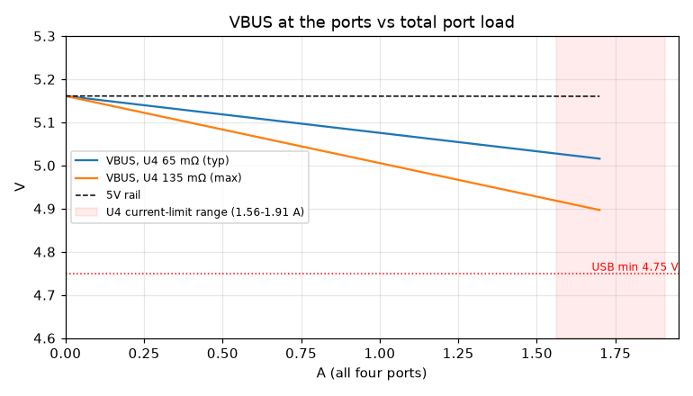

# USB port power: ngspice analysis

> **Out of date (2026-10-21):** the expansion header J2 has since been
> removed, along with its VBUS capacitor C22, ESD parts U7/D9 and diode D7.
> Hub ports 3 and 4 are now disabled, so U4 feeds only the two USB1 ports and
> VBUS has one 10 µF capacitor less than modelled here. The results below
> still assume the old circuit; re-run the simulation to refresh them.

This note covers how the board powers its four USB ports: two USB-A
(USB1) and two on the expansion header (J2). It asks three questions:
- How far does VBUS sag when a device is plugged in?
- Does a hot-plug or a shorted port pull the CM4's 5 V supply out of
  range?
- What does VBUS sit at under full load?

These questions are linked to the [5 V buck study](power-5v.md). The buck's
5.16 V setpoint was chosen for USB margin, at the cost of headroom against
the CM4's 5.25 V limit.

The simulation files are in [usb-power/](usb-power/); see its
[README](usb-power/README.md) for how to re-run them.

## The circuit

**U4 (AP22653)** is a current-limited power switch from the 5V rail to
VBUS.
- R17 (15k) sets its limit to 1.735 A (1.56–1.91 A). That's shared by all
  four ports.
- When overloaded it holds that current constant. Into a dead short it
  folds back to 0.47 A.
- The USB hub enables it through D6/D7 whenever any port is powered.

**VBUS** has:
- C7, a 100 µF tantalum;
- C9–C12 and C22, 5 × 10 µF ceramic;
- C8, 100 nF;
- D8 and D9, SMF6.0A TVS diodes at the connectors.

**The 5V rail** is modelled with the averaged AP64501 buck from the 5 V
study, with the CM4, hub and Ethernet drawing 1.4 A. So anything U4 does
shows up on the CM4's supply.

**The limits that matter:**

| Signal | Limit |
|---|---|
| VBUS at a hub port | 4.75–5.25 V (USB 2.0) |
| VBUS droop on the other ports when a device is plugged in | 330 mV maximum (USB 2.0) |
| CM4 5 V input | 4.75–5.25 V |

## Hot-plug

**The test:** one device already draws 0.5 A. A second device is plugged
in through about 1 m of cable.
- Its input capacitance is either 10 µF (the most USB 2.0 allows a device
  to present) or 47 µF (a non-compliant device; they exist).
- U4 is at either its typical (65 mΩ) or maximum (135 mΩ) on-resistance.

**The panels:** VBUS as the other ports see it (left), the CM4's 5V rail
(middle), and U4's current (right).

| Device | U4 | VBUS droop | VBUS minimum | 5V minimum | U4 peak |
|---|---|---|---|---|---|
| 10 µF | 65 mΩ | **120 mV** | 5.00 V | 5.12 V | 1.5 A |
| 47 µF | 65 mΩ | 219 mV | 4.90 V | 5.05 V | 2.1 A |
| 47 µF | 135 mΩ | 248 mV | 4.83 V | 5.07 V | 1.7 A |

- **VBUS:** most of the new device's charge comes from the VBUS
  capacitors, which share it through the cable. Even the non-compliant
  47 µF device keeps the droop well inside 330 mV, and VBUS never gets
  near 4.75 V.
- **U4:** with a large device it briefly passes more than its 1.735 A
  limit (2.1 A), because the limit takes a few microseconds to act.
- **5V rail:** the CM4's supply dips by at most about 110 mV and recovers
  within 100 µs.

## Port short

**The test:** a dead short (50 mΩ) on a port from 5 to 10 ms.

**Left panel:** U4's current as the short starts.
- For about 3 µs only U4's on-resistance limits the current, and it spikes
  to **11.4 A**.
- Then the current limit takes hold.
- With VBUS near 0 V, the limit folds back to 0.49 A.

**Middle panel:** VBUS collapses for the length of the short. The CM4's 5V
rail barely moves.

**Right panel:** the 5V rail at each edge.

| Moment | 5V rail |
|---|---|
| Short applied | dips to 4.94 V |
| U4 cuts back | touches 5.251 V for 8 µs, right at the CM4's limit |
| Short removed | peaks at 5.24 V |

VBUS is back above 4.75 V 0.5 ms after the short is removed. In that time
U4 recharges the VBUS capacitors at its current limit.

A shorted USB device or cable doesn't disturb the CM4. The tiny touch of
5.25 V is the same setpoint-headroom issue described in the
[5 V study](power-5v.md#load-steps).

## Steady load

**The test:** VBUS at the ports as the total port load rises to 1.7 A, just
under U4's limit, with U4 at typical and maximum on-resistance.

| Port load | VBUS, U4 65 mΩ | VBUS, U4 135 mΩ |
|---|---|---|
| 0.5 A | 5.12 V | 5.08 V |
| 1.5 A | 5.03 V | 4.93 V |
| 1.7 A | 5.02 V | 4.90 V |

- Even with U4 at its worst-case resistance and at its current limit,
  VBUS stays 150 mV above the USB 4.75 V minimum.
- The buck's low-tolerance corner (5.10 V instead of 5.16 V) would take
  about 60 mV of that, which still leaves margin.
- This confirms the reasoning behind the 5.16 V setpoint on the Power_5V
  sheet.

## Assessment

USB port power is well designed:
- **Hot-plug droop is 120 mV for a compliant device,** less than half the
  330 mV allowed, and still inside the limit for a 47 µF device.
- **The VBUS capacitance is adequate.** The board has about 130 µF on
  VBUS, in line with the USB 2.0 guidance of at least 120 µF of low-ESR
  bulk capacitance on downstream ports. The droop results above confirm
  it's enough.
- **A shorted port is contained by U4.** The CM4's 5V rail stays inside
  4.94–5.25 V.
- **VBUS stays above 4.75 V at full port load,** even with U4 at its
  worst-case resistance.

**Observations rather than problems:**
- **The 5.16 V setpoint trade-off is real but correct.** USB needs the
  extra voltage, and it's why the CM4 side has only 90 mV of headroom. The
  largest excursion seen here was 5.251 V for 8 µs, at the edge of the
  limit and far below the CM4's 6 V absolute maximum.
- **The VBUS budget is 1.735 A for all four ports together.** A single
  high-power device (a USB disk drawing 0.9 A) plus another 0.9 A device
  will trip the limit. That's a software and usage limit, not a circuit
  fault, but worth knowing. U4's fault flag (nOCS1) tells the hub, and so
  the CM4, when it happens.
- **Not modelled: U4's thermal shutdown.** Holding a short at 0.49 A
  from 5.16 V dissipates about 2.5 W in U4, far more than its SOT-26
  package can shed continuously. A sustained short will push U4 into
  thermal shutdown, and it will cycle off and on until the short is
  removed. That's the intended protection, and the CM4's supply isn't
  affected, but the dynamics aren't simulated here.
